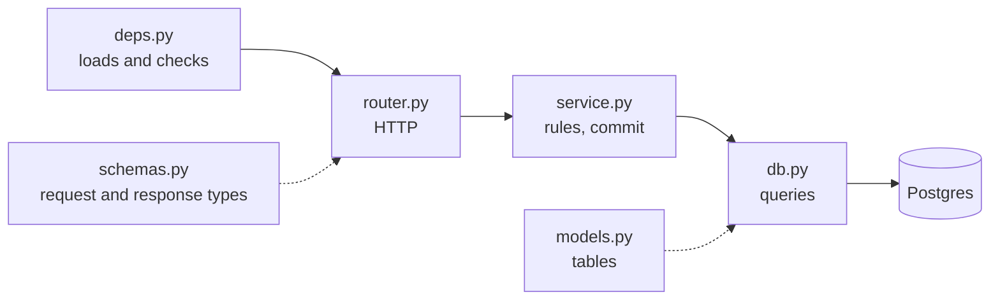

# Real Time Facial Recognition: API

The backend of the system. It uses Python, FastAPI, SQLAlchemy, Alembic and Postgres with pgvector. [uv](https://docs.astral.sh/uv/) manages the Python packages.

Run all the commands in this file from `api/`.

## Set up (one time)

Before you start:

- Make sure that uv and Docker are installed.
- Make sure that Docker is running.
- Make sure that nothing else uses port 5432. Each copy of the repo starts its own Postgres container on that port.

The setup writes the email and password of the first Platform Admin into `.env`. Use a test email and password. Do not use a real password.

### Option 1: the setup script

Run the script. It asks for the email, password and name of the admin. It also asks if you want the demo data:

```bash
uv run python -m app.setup
```

You can also give these values as arguments:

```bash
uv run python -m app.setup --email admin@example.com --password example-password --name "Admin name" --demo-data
```

Use `--no-demo-data` to skip the demo data.

If `.env` exists, the script asks if you want to keep it. Then the script does the steps of option 2.

### Option 2: by hand

1. Start Postgres. From the repo root, run:

   ```bash
   docker compose up -d --wait
   ```

   `--wait` waits until Postgres is ready. This creates the `building_entry` database. The tests create the `building_entry_test` database when they first run.

2. Copy `.env.example` to `.env`. Then set these values:
   - `SECRET_KEY`: a random text of 32 or more characters. To make one, run:

     ```bash
     uv run python -c "import secrets; print(secrets.token_urlsafe(32))"
     ```

   - `PLATFORM_ADMIN_EMAIL`, `PLATFORM_ADMIN_PASSWORD` and `PLATFORM_ADMIN_NAME`: the first Platform Admin.

   The database URLs are already correct for `docker-compose.yml`.

3. Install the packages, download the face models, build the database and create the Platform Admin:

   ```bash
   uv sync
   uv run python -m app.faces.download_models
   uv run alembic upgrade head
   uv run python -m app.users.create_admin
   ```

   The face models go into `face_models/`.

4. Optional: add demo buildings, terminals, admins and people:

   ```bash
   uv run python -m app.demo_data
   ```

   - The script is `app/demo_data.py`.
   - Each building gets a Building Admin. They sign in with `PLATFORM_ADMIN_PASSWORD`. Their emails are `demo.admin@example.com` and `harbor.admin@example.com`.
   - Each building gets 5 people. Their faces come from the public-domain portraits in `tests/fixtures/`.
   - You can run it more than one time. It skips the data that already exists.

## Run

```bash
uv run fastapi dev app/main.py
```

- The API runs on http://localhost:8000.
- http://localhost:8000/docs shows all the endpoints. You can try each endpoint there.
- The web app sends its requests to `/api`. The Vite proxy sends them to the API.

## Test

```bash
uv run pytest
```

- The tests use `TEST_DATABASE_URL`. They never use `DATABASE_URL`.
- Each test run creates the test database if it does not exist. Then it empties the database and builds it again with the migrations.
- Each test is rolled back at the end. Thus, the tests do not change each other's data.
- The face tests use the photos in `tests/fixtures/`. They need the face models.

## Code map

| Path | Contents |
| -- | -- |
| `app/main.py` | The app. It adds the routers and the session cookie. It changes a unique-index error into a 409 response. |
| `app/core/` | Settings, the database session, password hashing and terminal keys |
| `app/<feature>/` | One folder for each feature: `auth`, `users`, `buildings`, `terminals`, `people`, `access` |
| `app/faces/` | Changes a face photo into an embedding (OpenCV YuNet and SFace) |
| `migrations/versions/` | The Alembic migrations |
| `tests/` | One folder for each feature. `schema/` tests the database rules. `fixtures/` has the face photos. `conftest.py` sets up the test database. |

## Layers

Each feature folder has the same files. A request goes down through the layers. Each layer calls only the layer below it.



| File | What it does | Rules |
| -- | -- | -- |
| `router.py` | The HTTP part: the path, the status code, and the request and response types | It has no rules and no queries. It calls one service function. |
| `deps.py` | It loads and checks the data that a route needs before the route runs. Examples: `SignedAdmin`, `ManageableBuilding`. | It returns 401 or 404 if the check fails. A route gets it as a parameter. |
| `service.py` | The rules: who can do what, and which data is valid | It returns a clear error for each broken rule. It calls `session.commit()` one time, as its last step. |
| `db.py` | The SQLAlchemy queries | It has no rules and does not commit. It calls `flush()` when it needs the id of a new row. |
| `models.py` | The database tables | Each change needs a new migration. |
| `schemas.py` | The Pydantic types for the requests and responses | Each endpoint has one `Request` class and one `Response` class. |

### Example: `POST /buildings/{building_id}/terminals`

1. `deps.py`: `SignedAdmin` loads the admin from the session cookie. `ManageableBuilding` loads the building. If the admin cannot manage the building, it returns 404.
2. `router.py`: FastAPI checks the request body against `TerminalCreateRequest`. Then the router calls `service.add_terminal`.
3. `service.py`: If the building already has a terminal with that name, it returns 409. If not, it calls `db.py` to add the row. Then it commits.
4. `router.py`: It returns the new terminal as `TerminalCreateResponse`, with status 201.

## Add a feature

1. Make a folder `app/<feature>/` with the files in [Layers](#layers). Use `app/buildings/` as an example.
2. To let only signed-in admins use an endpoint, add `admin: SignedAdmin` to its parameters. `SignedAdmin` is in `app/auth/deps.py`.
3. If you change a `models.py`, make a migration and apply it:

   ```bash
   uv run alembic revision --autogenerate -m "..."
   uv run alembic upgrade head
   ```

4. Put the tests in `tests/<feature>/`.
